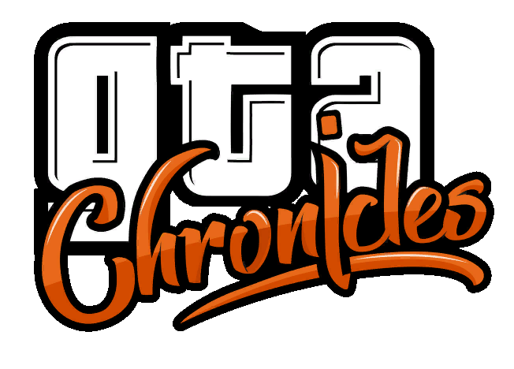
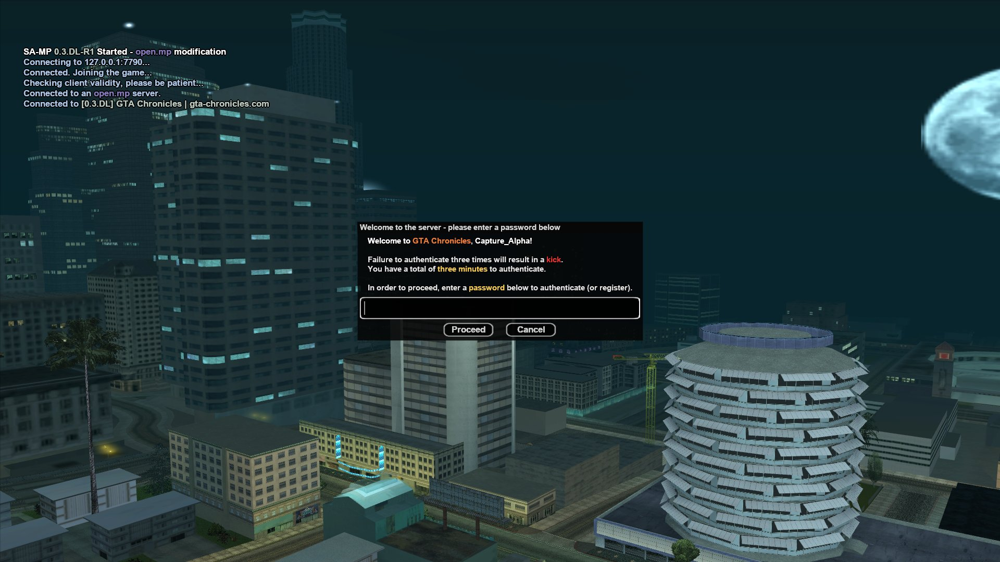
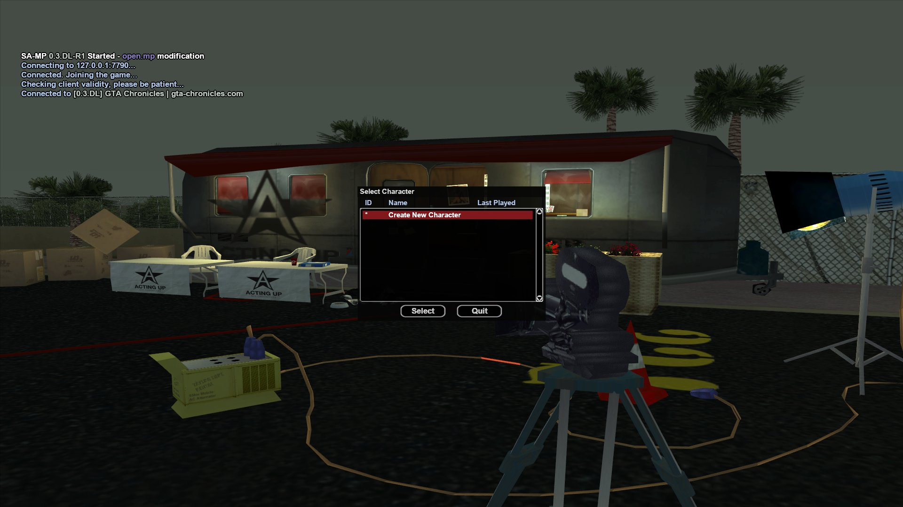
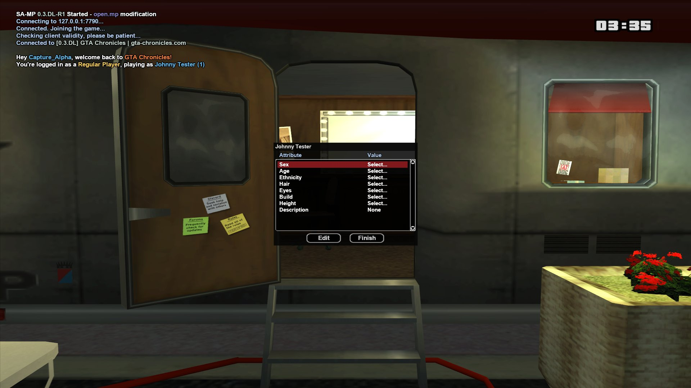
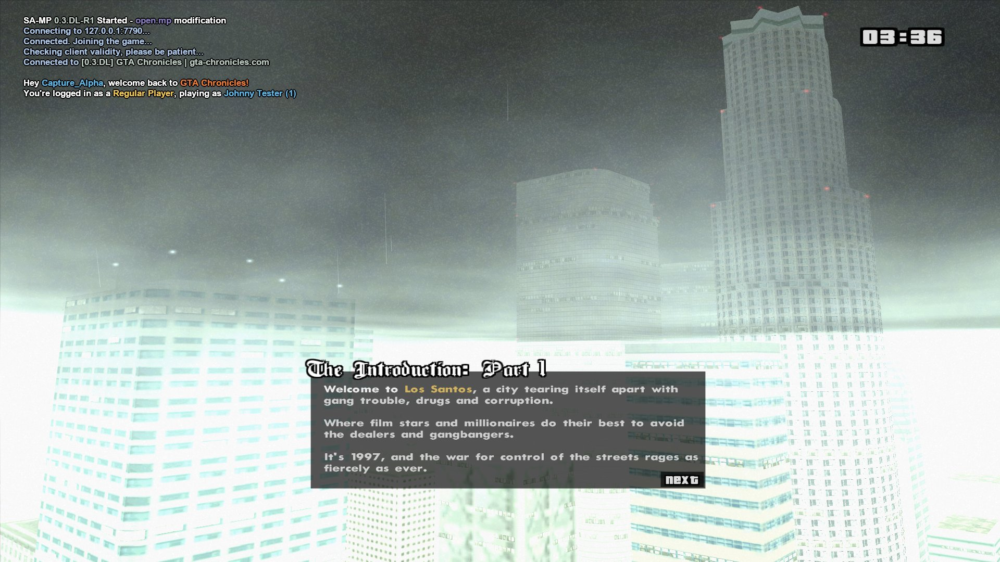
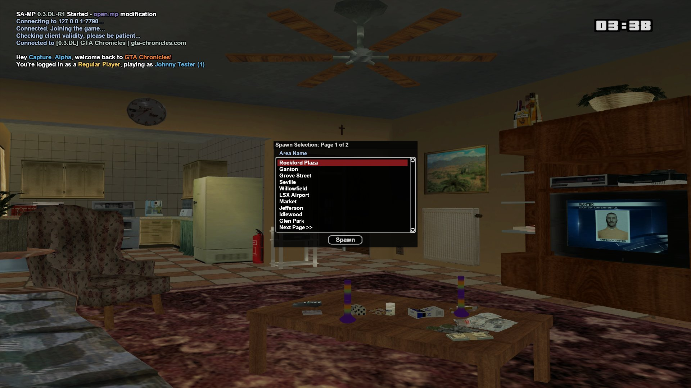
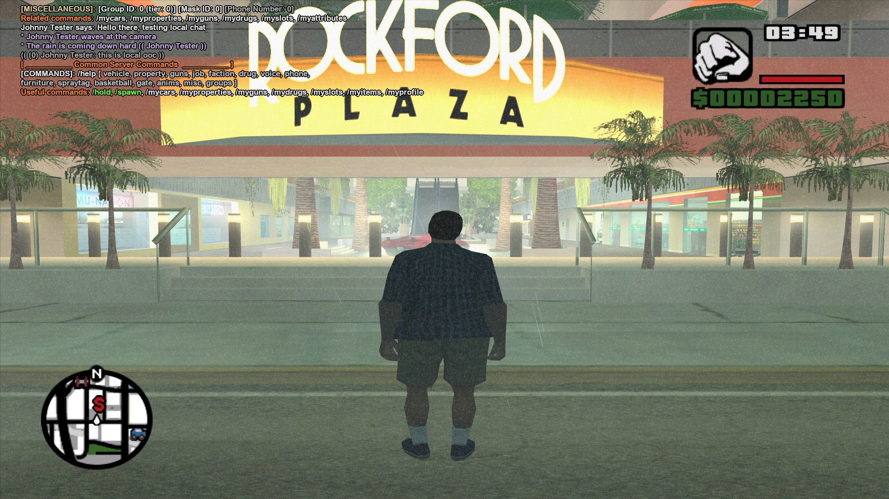
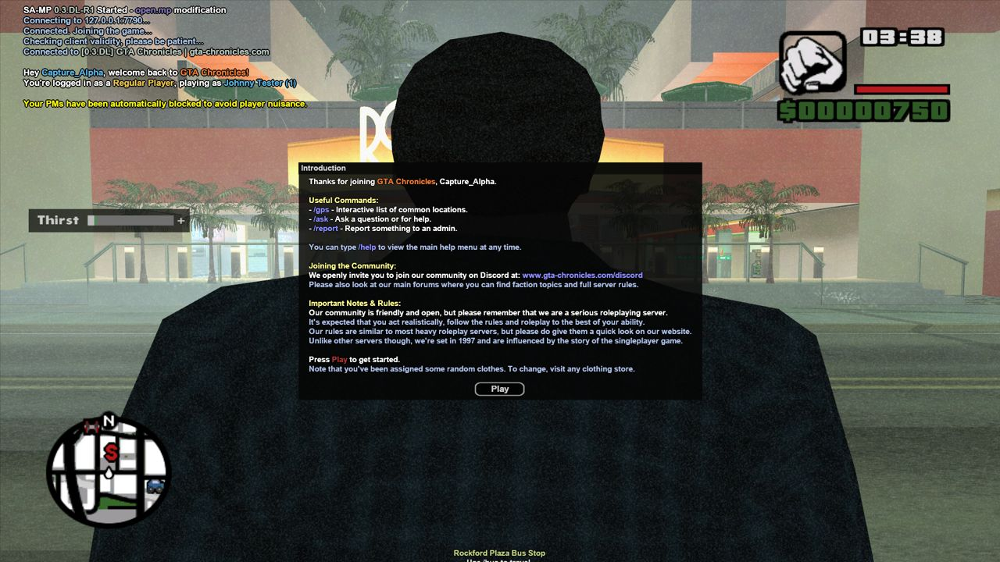
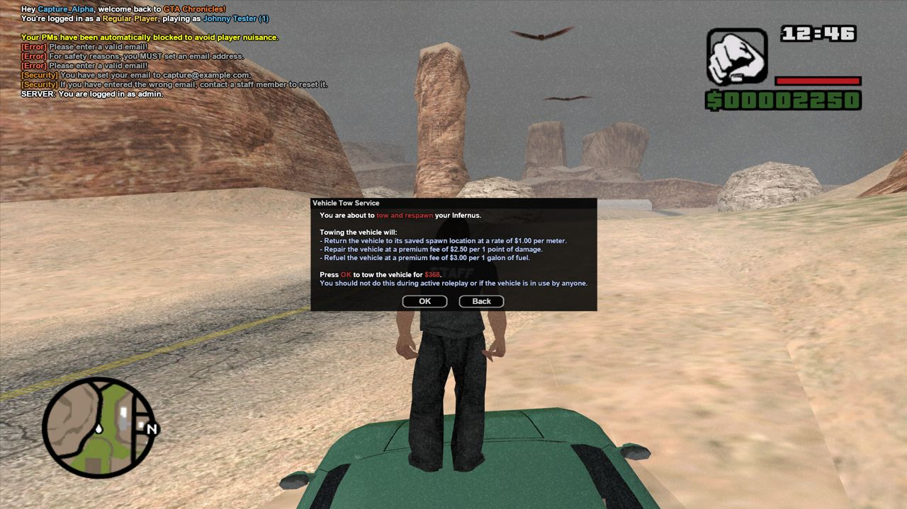

<p align="center"></p>

# GTA Chronicles 1.4.8
This is the GTA Chronicles gamemode as it ran in December 2022, version 1.4.8 R8. It started out as the SOLS gamemode I wrote in 2019. Spooky helped me turn it into GTA-C early 2022. Late 2024 it turned into what is SP-RP. The SP-RP version is already public [here](https://github.com/DignitySAMP/SP-RP). This repository is the last version before that happened.

| | |
|---|---|
|  |  |
|  |  |
|  |  |
|  |  |

It's a passion project written by a great number of passionate developers for an ungrateful community that has been allowed to play for free for many years, all the while the developers worked around the clock, wasting money on resources, just for them to try and dox the people responsible for making this great.

I hope that with the release of this script, people can look at some of our techniques, innovative solutions and learn from our mistakes. It's nothing great under the hood, but hosted over 200 concurrent players at its peak.

At the point of this version, we had over 1850 commits. Thanks to these people for making it great.

## Credits

Major contributions:
 - DignitySAMP / PXL-DavyL: primary contributor / project lead and creator
 - Spooky/Sporky: contributed towards the shift from SOLS to GTAC, including hundreds of QoL changes
 - Rusu: primary contributor towards bug fixes and QoL changes during the entire duration of the project

Minor contributions:
 - Matz (basketball and trucking)
 - LorenC (pool script, poker script, etc, all 100% written by him for SFCNR)
 - LS-RP (DamianC): the < 2011 furniture array
 - PatrickGTR, Matz, DenNorske, Kubi and Patryk: Open sourcing small systems that the server uses.
 - DTVSamp (minor QoL changes)
 - Shabo/plsegott (old item prop system for beer and food)

Special thanks:
 - DenNorske (helping us fix the problems we couldn't fix ourselves, usually hidden kill switches or infinite loops, and later DDoS protection adjustments)

## Summary

The code is pretty much the same as it ran on the last version of GTA-C v1. I only changed what was needed to get it running on open.mp with the latest includes and plugins. Apart from that I fixed over 150 bugs from the original. Passwords are now hashed with bcrypt (originally sha256). The original repository remains private. There is sensitive data in commits that do not belong in the public.

## Building and running

You need [sampctl](https://github.com/Southclaws/sampctl), the [open.mp server](https://github.com/openmultiplayer/open.mp/releases) (1.6.7 or newer), MariaDB or MySQL, and a SA-MP 0.3.DL client to connect with.

Build the gamemode:

```
sampctl ensure
sampctl build main
```

Set up the server:

- Unpack the open.mp server somewhere. Copy `gamemode/gamemode.amx` into its `gamemodes/` folder. Copy `models/`, `scriptfiles/` and `config.json` from this repo into the server folder.
- Put these in `plugins/`: crashdetect 4.22, streamer 2.9.6, MySQL R41-4 (with `log-core.so` on Linux), samp_bcrypt 0.4.1, ColAndreas 1.5.0 (the static build), pawn-fsutil 1.3.0 and Pawn.Regex 1.2.3-omp.
- Put these in `components/`: sscanf 2.13.8, Pawn.RakNet 1.6.0-omp and discord-connector 0.3.6. The Discord bot token goes in `config.json` under `discord.bot_token`. Leave it empty if you don't use Discord.
- ColAndreas needs its database at `scriptfiles/colandreas/ColAndreas.cadb`. It's not in the repo because of its size. Build it with the ColAndreas wizard or take it from a ColAndreas release.
- Change the rcon password in `config.json` and set `network.public_addr` or `artwork.cdn` like on any other 0.3.DL server.

Set up the database:

- Create an empty database and a user for it, then import `schema.sql`.
- Rename `mysql-example.ini` to `mysql.ini` and fill it in.
- Log in with rcon to get full admin rights, or set `account_stafflevel` on your account in the database.

Start it with `./omp-server` (or `omp-server.exe`) and connect with a 0.3.DL client on port 7788.

## Notes

Some account ids are hardcoded from when the server was live. Accounts 1 and 6949 get a hidden /x chat (this used to be Dignity and Spooky's personal chat). Accounts 16341 and 16524 show up under an alias in /a. Account 1 (Dignity's old ID) has PMs blocked automatically. On a fresh database the first account you register becomes account 1 so keep that in mind, it's meant to be the 'owner' account...

Plenty of bugs were fixed, including the dodgy vehicle system. It no longer depends on MAX_VEHICLES... The anticheat is a bit outdated still so if you intend to use this you have to find a decent replacement. Everything was tested with 3 people in a 0.3dl. The indentation remains quite outdated so you might want to run a linter on this lest you don't want to scratch out your eyes. 

## Features
I tried summarizing what's in here, but it's far too much to mention. In a nutshell, this script has everything you could possibly need, built over years of QoL updates:

Dynamic properties
 - Houses and businesses are properties.
 - Every business has scripted income when a player does /buy
 - Extensive furniture system (interior only, players can upgrade their interior without needing admins)
 - Wardrobe system (saves your skins, lets you switch to them inside your house)
 - Realty system: properties get auto sold after 50 days of owner inactivity and can be found centralised at the /listings point
 - Property robbery script written by PatrickGTR for open CNR (EnEx models with actors that you can rob)
 - Property specific actions (/doorme, /doordo, /doorknock, /doorbell, /doorshout)
 - Property storage for guns and drugs
 - Many little QoL systems such as coloured property names and more
 - A large number of admin and user commands for flexibility
 (admins can change every aspect of your business)
 - Extensive buy types, check out /buy and the functions surrounding it.

Dynamic vehicles
 - Static and player owned vehicles support
 - Vehicle tuning system, linked to modshop properties. Features all possible components available in the game
 - Vehicle damage saving, post parking the car
 - Serverside pay and spray system with paintjob support and all SP colors
 - Basic fuel system, with dynamic fuel pump placement (objects) and ownable fuel stations. Refueling has an interface.
 - Unique singleplayer inspired vehicle GUI that's toggable in /settings
 - Car scrapping and car transfer/selling functionality
 - Impounding system for LSPD
 - Basic air traffic control for aircrafts to communicate with LSPD
 - Basic rental system
 - /rprf point system for jobs, factions, ... that fixes and repairs cars
 - Basic static dealership system hosting all non OP cars with prices relevant to our economy
 - DMV system featuring a theoretical quiz
 - Serverside colors and respawning system (a bit buggy, this module needs to be rewritten)
 - Vehicle window script that deters chat and is synced with all other local chats

Dynamic factions
 - Extensive member control (offline player support)
 - Faction tiers determine the power a player has in a faction (3 lowest, 2 command, 1 leader)
 - Dynamic faction ranks: no hard scripted nonsense, /setrank id title
 - Basic faction bank system = it works but was never emphasied upon
 - Faction skins that are semi dynamic, but need to be reworked. You add faction skins with a command and they show on the faction spawn
 - Armory system for LSPD, EMS and government factions, lets you get guns based on squad and tier
 - Communication (f chat, toggable by tier2+, pager system for factions for IC communication, LSPD radios)
 - Faction spawns that allow people to change skins and spawn at this position when they first log in
 - Squad system for the LSPD
 - Many more admin and player commands for system flexibility, too many to mention

Minigames
 - Pool script: written by LorenC for SFCNR, ported to this gamemode, very minor adjustments made
 - Basketball system: very outdated module written by Matz that tries to encapsulate the singleplayer basketball game. Old, unoptimized, but it works.
 - Poker script: the files are in the repo but the include is commented out. Comments in the code list textdraw overlap, tables disappearing after a restart and the .amx growing by 20 MB.
 - /shakehands: should feature most if not all the greetings found in the base game with descriptions of what they do.

Jobs
 - Dockworker: you get in a forklift and /cargojob gives you a random pickup point and a random drop-off point (3 of each). Payouts depend on the route and a streak bonus. This is the entry level job to get you started, very afkable.
 - Garbagejob: you enter a trashmaster and you pick up trash around the city, this gets marked on the map and you use LALT to pick it up the trash on foot and put it in the truck. Payout per item put in the truck. This is an entry to medium level job, intensive but afkable nonetheless.
 - Trucking job: the end game job. You go to a wholesaler and buy a crate with your own money, drive it to a store and sell it there for 2.5 times what you paid. This earns the most over time by far.

Injury
 - Serverside damage system, depending on weapon bullets and base damage (hard coded), dependant on distance. Body part hit decides kevlar reduction and which wounds and afflictions you get
 - Injury mode and execution system
 - Taser, tackle, and beanbag system for the LSPD.
 - Synced knife damages (open.mp keeps the default knife sync, which is all the old SKY plugin was used for)
 - Basic /damages to show your damages
 - If you get shot in the arm, your screen will shake
 - If you get shot in the leg, you will stumble when you sprint
 - /surgery at a hospital heals all afflictions

Gym script
 - Singleplayer inspired gym script
 - You can train muscle and weight, at the cost of hunger, thirst and energy. 
 - Hunger and thirst are replenished by buying food at a restaurant, this auto consumes.
 - Energy will automatically replenish over time
 - Singleplayer pop up script with a progress bar and green/red based on loss or gain
 - SPRINT+C or /gymstats to show the singleplayer box showing your current stats
 - If your weight and muscle levels are high enough you can get a custom fightstyle (grab kick, boxing or kung fu) at a gym fightstyle point. It expires after some paychecks if you do not keep the levels up (this can also be set by admins as per our early donation package)
 - All gyms are hardcoded.

Weapons
 - Serverside weapons, ability to add custom gun names
 - Serverside ammunition, a large factor into determining damage. Easy to add more or change names.
 - Weapons save post /q, are properly removed when needed (hospital, jail, ajail, ban, /q during injury mode, etc) and can be stored in your vehicle or property
 - Unused "visible.pwn" which was a working prototype (with some bugs) for putting weapons visibly on the body of a player. If you want this to work, you must first adjust the attachment linit in attachments.
 - Serverside drivebies: as a passenger you double tap crouch to start a driveby. The server re-arms the weapon.
 - In the event of abuse, a gun ban on the account blocks the player from using weapons.
 - Because of the serverside weaponids and ammunition, we can easily cancel all incorrect data. This makes weapon hacking impossible.

Drugs
 - Weed: can be grown by buying a weed seed at the cartel and placing it with /drugsetup. Ticks over time, need to pass several stages before it will grow fruitfully. Using weed heals you over time.
 - Cocaine: same concept as weed. Using cocaine gives you extra melee damage
 - Crack: cooked from powder bought at the cartel. Using crack gives you temporary armor that replenishes for as long as the effect is active.
 - Effects last depending on the strain and the amount of grams used.
 - Basic system to split drugs into different containers. All containers are bought from general stores or restaurants.

Chopshop
 - Bring a car to this place to make some quick money, it damages the car to minic the "scrap" effect, then you must drive it away to get the reward.
 - Can be owned by a faction, they take a little cut from the ordeal.

Carjacking
 - Lockpicking and hotwiring system, both have GUIs and act as a minigame.
 - Inspired by GTA-W's old hotwire/lockpick system, remniscent of real life

Boomboxes
 - Ability to stream an official radio channel or a custom link.
 - Placeable through the SAMP object editor, shows a label.
 - If the owner quits, it can be claimed for 5 minutes.
 - Admins can remove boomboxes.
 - Boomboxes use their own proxdetector to send messages to surrounding players in the event of becoming unclaimed or removed.
 - Extensive debugging done to this over the years, should automatically sync and prioritise with vehicle and property stations.

Anticheat
 - External support for paused players and detection
 - Cheats detected:
    - AFking
    - Botting (clients with the wrong version get their IP blocked for 5 minutes)
    - Anti bunnyhop
    - Carjack detection
    - Car troll hack
    - Car warp detection
    - Double connection detection (logging into a master account that is already connected)
    - Simple ban evader script (scans the subnet of all banned players, if there's a match, it alerts admins)
    - Spectate detection
    - Jetpack detection
    - Ammo hack
    - Weapon hack

Attachments
 - Dynamic buypoints that can be linked to a property so the property owner can get income
 - Ability to buy several objects to attach to your player
 - Saving toys and their last edited positions over /q
 - Using the SAMP attachment editing system
 - Basic system, but does the job.
 - Helper functions to recognise bones, slots, etcetera (synced to the other modules)

Animations
 - Basic animation module.
 - Sorted anims with options and single animations per file
 - "Particle" animations that have effects such as /piss, /shit, /puke, /shakebottle
 - Anti abuse /stopanim (also detects when it's being used to avoid stuns in melee battles)
 - Thanks to Emmet_, Reyo, niCe, BigBear amd DamianC (yoinked some LS-RP anims)

Admin
 - Hundreds of admin commands for everything imaginable
 - Spectating system, etcetera
 - Hundreds of extra commands for the other systems
 - Reports come in and are logged.
 (/ar and /dr to accept or deny respectively)
 - Basic admin level system with titles, /ahide, and much more
 - Way more features, impossible to cover it all

Helper
 - Questions come in through /ask, helpers can /ah to accept and /answer to answer
 - Questions are logged and helpers can list pending ones with /questions
 - Some other small commands are accessible to them

Contributor
 - Ability to invite others to /ac (admin chat) with /acinvite. Contributors have a rank: veteran (no admin powers), invited, developer, manager or advanced admin

Spraytags
 - Static spraytags remniscent of singleplayer
 - Ability to tag custom text, featuring a coloring system and more
 - Admins can track who sprayed what and wipe them
 - LSPD can also wipe them

Phone script
 - Textdraw clickable phone system
 - Ability to save contacts and call/sms using the contact names
 - Dialog/textdraw based or using basic commands
 - Ability to customise your phone with backgrounds and colors

Police script
 - Ability to use /carsign
 - Squads and armories
 - Amazing LSPD interior by Spooky, converted from a Redwood RP interior and overhauled in July 2022 with help from Ryhes and Reyo
 - Ability to use /bk and /panic (shows markers on minimap)
 - Entire penal code is scripted (dialog based), synced with /fine and the criminal record commands
 - Intricate fine system, fines auto expire and need to be paid by players
 - Custom 0.3DL lightstrobe effects for sirens
 - Custom /siren script, synced with lightstrobes
 - Mole script
 - Spike script
 - Soundproof interrogation rooms
 - Gunracks
 - No MDC, but /cad for unit organisation and helper commands to look for character info and car info.
 - Intricate dialog and request based frisking system

Hitman script
 - Players call 666 to make a contract
 - Hitman has to visit the caller and manually assign data in a contract menu to avoid metagame
 - Once the hitman accepts a contact, they can mark the target.
 - Killing a target when they're marked will block them from using a character for 2 hours

Player accounts
 - Accounts can be registered ingame
 - Basic tutorial explaining the basics
 - Email prompts for UCP support
 - Max 5 character slots
 - Intricate spawning system, allowing you to spawn at your property, faction, a public spawn or your last position
 - Ability to add attributes to your character (height, weight, eye color,  hair color, body build, and more) => /examine system
 - /settings that lets you customise a bunch of things regarding the interface, per player
 - A ton of other things, too much to mention

Gates
 - Ability to create custom doors, gates and garage doors
 - Can be assigned to factions, properties, or be player owned
 - Ability to animate them or just have them open automatically
 - Ability to convert them to tolls, police can /policetolls
 - Ability to add autoclose

Passpoints
 - Ability to add /pass points, useful for backdoors or rear windows
 - Everything is customisable, range, color, name, and who can use it
 - Ability to /pass on foot or on vehicle (depending on type)

GPS
 - Ability to go to points of interest
 - Ability to go to enex /buy points
 - Ability to go to houses or properties
 - Always finds the nearest entity and sorts it accordingly (shown to player)

Custom nametag system
 - Powered by Raknet
 - Synced in the scoreboard, tablist, and proxdetector
 - Custom sscanf handler to make the use of both playerids and firstname_lastname compatible.
 - Players can choose in /settings between names only and names with healthbars

News system
 - Ability to do /breaking (admins got /abreaking) for a breaking news announcement
 - Ability to go live and invite people to your talkshow (players can do /broadcasts and tune in or out)
 - Faction type = news
 - Adds /mic support to businesses

Player logging
 - Most advanced player logging system ever seen on SA-MP, written by Spooky
 - Ingame log browser, sorted by type
 - Used throughout the script, stores important player data per store
 - Shows the last 75 logs when showing logs
 - Ability to show all logs, online player log, or offline player logs. (/plogs, /plog, /oplog)
 - Admin level restriction support

Server config
 - Stores a bunch of information that's dynamically appended:
 - Server time and date
 - Motd (three lines, with editor and edit time)
 - Login song
 - Admin chat hex color
 - More minor stuff not worth mentioning

Spawnables/Holdables
 - Players can dynamically put down objects, or hold them
 - This is useful if a player wants to host a BBQ or an event, simply /spawn and map the objects themselves
 - Equally, in a bar, you can use /hold and equip a beer bottle or a glass. There are also food items or other useful items to aid you in your roleplaying situations.
 - Made by Spooky: this is the best way for players to immerse themselves and their scenes: players put down their own RP objects or hold RP props to benefit their screenshots and environment.

Gun factory
 - Faction gun production: collect wood, metal and parts at collection points, then /assemble at a factory.
 - Two factories, each reserved for one faction.
 - Black market with gun packages that can be passed on and finalized.
 - You need hours played before you can use guns.

Licenses
 - Driver, gun, PF and CCW licenses, /showlicense and /badge for police.

Strawmen
 - Management picks players who sell packages of weapons, ammo and drugs.
 - Every package is logged. A strawman can only get new ones after selling the old ones.
 - Own strawman chat with /sc.

Groups
 - Player groups and companies with chat, ranks, cars, tow cars, motd and an activity list.

Donator
 - Donator ranks and donator chat.

Government and FBI
 - City Hall with an elevator and government squads.
 - FBI building with an elevator.

Mall, fireworks and vending
 - Mall with a car show turntable and a ribbon cutting.
 - Fireworks (Advanced Fireworks by Basssiiie), /fireworks and /shootfireworks.
 - Ecola and Sprunk vending machines.

Discord
 - Advertisements are posted to a Discord channel. Players can use some commands from Discord.

Model browser
 - Dialog model browser, used by the toy and clothing stores.

Voice lines
 - /vl plays voice lines for Families, Ballas, Vagos, VLA and LSPD.

More police
 - /cad to organise units.
 - 911 calls, arrest and jail times, mugshots with a camera flash.
 - Cuff, detain, tie up, rights, confiscate, disarm, plate and data searches, backup and panic responses.
 - Sheriff station in Dillimore.

Fire department, DEA and maps
 - Usable fire hose and LSFD station 2.
 - DEA front company interior.
 - Extra map files: Villa Tropea, jewel store, dock fence, memorial, Hogan's Alley and some SA-MP interiors.
 - Gang zones loaded from the database.

Vehicles and transport
 - Blinkers, seatbelt, helmet, neon, toolkit, towing, car keys.
 - Guns and drugs can be stored in car trunks.
 - Taxi faction with /taxiad and /acceptcall.
 - /bus to travel between spawn areas.
 - Car alarms alert the police, /smashwindow, /buylockpick.

Money
 - /pay and /givemoney, bank with /balance, /deposit, /withdraw and /savings.
 - Paycheck with a bank statement, salaries per faction type and a duty bonus.
 - Property keys, property auctions, adverts and house, business and car limits (/myslots).

Players and staff
 - /mask with mask IDs.
 - Help commands per topic and random tips.
 - Admin tools: maintenance mode, VPN check, name changes, notes, ajail, bans, noclip, refunds.
 - /lock for passpoints, gates and properties.
 - Wrong client versions get their IP blocked for five minutes.
